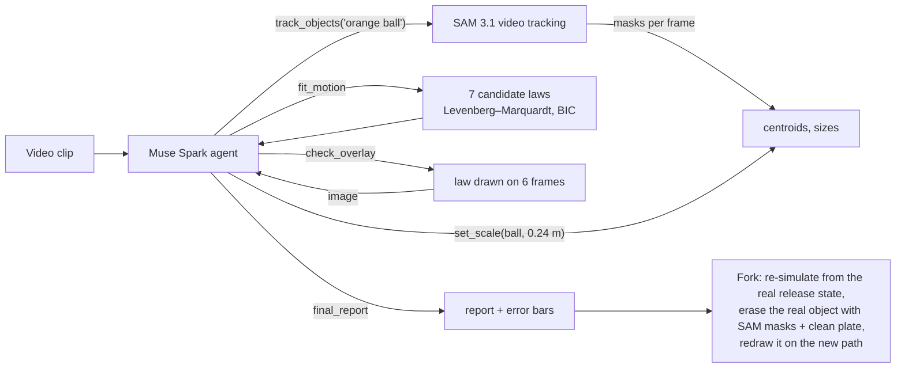

# Reality Fork

**Film anything that moves. Get its physics. Then change them.**

Reality Fork turns a few seconds of ordinary video into a physics experiment. An agent built on Meta's models watches the
clip, tracks what moves, measures it, works out which law of motion explains it, reports the numbers with honest error
bars, checks its own answer against the footage, and then lets you *fork reality*: replay your own footage with the Moon's
gravity, without air, or with a bouncier ball, while everything else in the shot stays as filmed.

> Demo video: _link_ · Live app: _link_ · Built for the Meta Global AI Developer Hackathon (Oct 27 – Nov 4, 2026), Indie track,
> theme "Push the Frontier": accelerate a scientific experiment, understand a physical system.

## Why

Measuring motion from video is a standard tool in engineering, robotics and lab science (drop tests, impact tests,
tuning a simulator to match the real world), but today it means a high-speed camera and clicking points frame by frame
in tools like Tracker or ProAnalyst. Reality Fork does the whole loop from a phone clip, and shows its working.

## What Meta's models do here

| Model | Job in Reality Fork | Why it matters |
|---|---|---|
| **SAM 3.1** (video, text prompts) | Follows the object named by the agent through every frame and returns a pixel-accurate mask per frame. We turn each mask into a sub-pixel centroid and size. | Segmentation used as a **measuring instrument**: on our test scenes its centres land within 0.2 px of the truth. |
| **Muse Spark 1.3** (video in, tool calling) | The scientist. Watches the clip, decides what to track and what sets the scale, calls the tools, reads the fits, inspects an overlay image of its law on the footage, and writes the report. | An agent that **verifies** itself: it retries prompts that find nothing, isolates the free-flight part of a motion when hands interfere, and only reports numbers the tools produced. |
| **Muse Image 1.0** (editing) | Repaints the scene as the Moon, Mars or Jupiter for the forked replay. | The fork keeps your footage's layout while the world changes around it. |
| **Muse Voice Transcribe** | Ask your question out loud. | Hands-free while filming. |

## How it works



1. **Track.** SAM 3.1 returns a mask for the object in every frame. Centroids are mask means (steadier than box centres);
   sizes come from the mask's principal axes, measured across any motion blur.
2. **Scale.** Pixels become metres from something of known size: the moving ball itself when it is a standard ball, a
   sheet of A4, a door. Its uncertainty is carried into every length and acceleration.
3. **Fit.** Seven laws compete: constant velocity, free flight, flight with quadratic air drag, bouncing (with restitution),
   pendulum (full nonlinear, damped), rolling down a slope, and a damped spring. Each is fitted by robust
   Levenberg–Marquardt, scored by BIC on a common capped loss, and returns derived quantities (g, e, L, period…) with
   propagated 1σ errors.
4. **Check.** The chosen law is drawn over six real frames; the agent looks at that picture and the worst miss in pixels
   before it may report.
5. **Fork.** The fitted law is re-simulated from the object's real state at release with changed parameters. In the
   replay, each frame's SAM mask is filled from a clean background plate (the per-pixel median of the clip, aligned
   exactly), and the object's cut-out is drawn on the forked path.

## Accuracy

See [bench/RESULTS.md](bench/RESULTS.md): the full agent run end to end on test scenes rendered with exactly known physics
and on real footage. _(numbers to come)_

## Built during the hackathon

Everything in this repository was written during the event (Oct 27 – Nov 4, 2026); the commit history shows it. No earlier
project code is used. Third-party pieces: Meta's `@meta-sam/parser` (SAM output parsing) and ffmpeg.

## Run it

```sh
npm install
echo "MODEL_API_KEY=..." > .env      # a Meta Model API key from dev.meta.ai
npm start                            # http://localhost:8790
npm test                             # physics and parser tests (no API calls)
node bench/render-synthetic.mjs      # render the test scenes with known physics
node bench/run.mjs                   # run the agent on them and score it (paid calls; saved runs are reused)
```

Requires Node 20+ and ffmpeg. Paid calls go through a ledger with a budget cap (`RF_BUDGET_USD`, default $25) and
a disk cache, so replaying a finished run costs nothing. A typical live analysis costs about $0.02–0.15.

## Limits

Measurements assume a still camera and motion roughly in a plane facing it, with the scale object at the same distance.
The agent states these assumptions and warns when a clip breaks them.

## Credits

Clips are public domain or openly licensed; see [clips/SOURCES.md](clips/SOURCES.md). NASA footage is used under NASA's
media guidelines and implies no endorsement.
